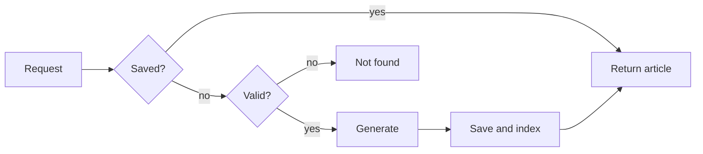

# Textura

Textura is a beautiful, modern dictionary in early development. Articles are AI-generated. Only US English is supported for now.

Try it [here](https://textura-umber.vercel.app/).

## Tech stack

- **Framework:** Next.js 16 (App Router)
- **UI:** React 19 + Tailwind CSS 4 + shadcn/ui (Base UI)
- **AI:** OpenAI Responses API (`gpt-6-luna`, structured outputs)
- **Validation:** Zod 4
- **Database:** [Neon Postgres](https://neon.com) + [Drizzle ORM](https://orm.drizzle.team)
- **Search:** [Algolia Autocomplete](https://www.algolia.com/doc/ui-libraries/autocomplete/introduction/what-is-autocomplete/)
- **Deployment:** Vercel
- **Typography:** [Source Serif 4](https://github.com/adobe-fonts/source-serif) + Inter, self-hosted

## Features

- **AI.** Articles are generated on-demand. The prompt follows a style guide inspired by Oxford Dictionary.
- **Caching.** Articles are generated once and stored in Postgres. Repeat lookups are instant.
- **Input validation.** Typos and unsupported queries, like non-US terms, are rejected by AI.
- **Design.** The Textura brand features a warm, literary palette. Article layout is inspired by traditional dictionaries.
- **Autocomplete.** Suggestions are shown as you type in the search box, drawn from previously generated articles. Articles are indexed as they’re created.
- **Keyboard navigation.** The whole app can be navigated with keyboard only.
- **Keyboard shortcuts.** ⌘⇧O to navigate back to the homepage. Or Ctrl+Shift+O on Windows and Linux.
- **Skeletons.** While the article generates, a skeleton is shown. The skeleton is delayed, so fast loads, like cached articles, don’t flicker.
- **Error handling.** Errors, like generation failure, show an error message.
- **Dark mode.** Every component has light and dark variants.

## Architecture

### Request flow

Previously generated articles load instantly: they're fetched from Postgres.

If the query is not found in Postgres, `gpt-6-luna` checks if the word is supported. Currently, Textura only supports US English. Phrases and idioms, inflected forms (_went_, _cats_), proper nouns, and contractions are not yet supported. Typos are rejected as well. If the check fails, a "No article found" message is shown.

If this check passes, the article is generated by `gpt-6-luna`, saved to Postgres and indexed in Algolia.

The check keeps junk input away from generation, the expensive step, and each word is generated once.



### Structured output

Articles are generated with OpenAI [Structured Outputs](https://developers.openai.com/api/docs/guides/structured-outputs) against a Zod schema, so the response arrives parsed and typed. The same schema types the Postgres column, the article page and the search index.

The article schema, simplified:

```ts
export const ArticleSchema = z.object({
  headword: z.string(),
  variety: VarietySchema,
  homographs: z.array(
    z.object({
      origin: z.string(),
      lexemes: z.array(
        z.object({
          lexicalCategory: LexicalCategorySchema,
          transcription: z
            .string()
            .describe('IPA transcription without slashes'),
          senses: z.array(
            z.object({
              definition: z
                .string()
                .describe(
                  'Lowercase phrasal definition with no terminal punctuation',
                ),
              example: z.string(),
            }),
          ),
        }),
      ),
    }),
  ),
});
```
